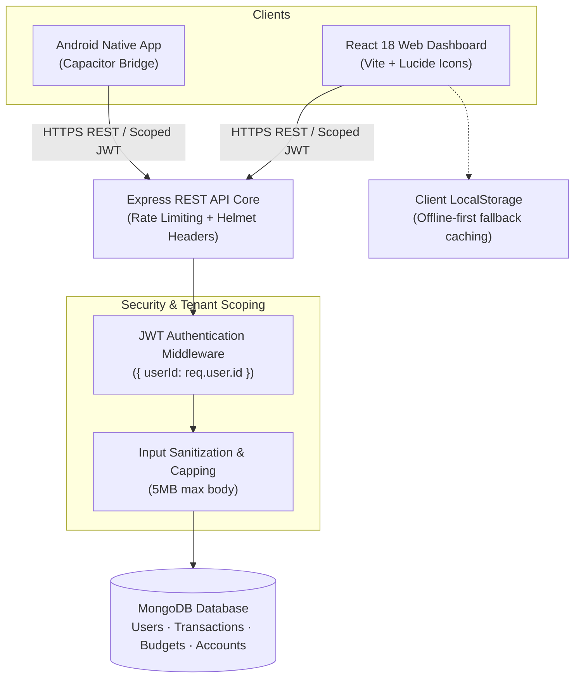

# Ledger — Cross-Platform Expense Tracker & Financial Analytics

> **Source Repository:** [github.com/Pradeep-B28/Ledger_Expense_Tracker](https://github.com/Pradeep-B28/Ledger_Expense_Tracker)  
> **Author:** [B Pradeep](https://github.com/Pradeep-B28) · [Portfolio](https://pradeep-b28.github.io/Pradeep-B28/)

---

## Overview

**Ledger** is a cross-platform personal finance and expense analytics application engineered with the MERN stack (MongoDB, Express, React, Node.js) and wrapped with Capacitor for native Android deployment. It provides multi-wallet transaction tracking, category budget thresholds, savings targets, and interactive cashflow visualizations with strict per-tenant data scoping and privacy-first local storage caching.



---

## Technical Specifications

| Component | Technology | Description |
| :--- | :--- | :--- |
| **Frontend Web** | React 18, Vite, Lucide Icons | Responsive dashboard with HTML5 History API routing and WCAG AA contrast |
| **Mobile Runtime** | Capacitor Android Runtime | Pre-configured Android Studio bridge for generating installable APK packages |
| **Backend REST API** | Node.js 18+, Express 4.x | Modular route controllers with JWT verification and helmet security headers |
| **Database & ODM** | MongoDB, Mongoose | Indexed tenant-isolated collections enforcing `{ userId }` scoping on all queries |
| **Authentication** | JSON Web Tokens (JWT) | Cryptographically salted passwords (`bcryptjs`), stateless bearer tokens |
| **Privacy Compliance** | DPDP Act 2023 / GDPR alignment | One-click machine-readable JSON data export and account erasure endpoints |

---

## Key Features

1. **Strict Tenant Data Isolation:**
   - Every read, update, and deletion query strictly filters by `{ userId: req.user.id }`, guaranteeing complete isolation between accounts.
2. **Interactive Financial Analytics:**
   - Visual category distribution donuts, monthly spending trends, and budget threshold progress indicators.
3. **Offline-First Local Storage Caching:**
   - Fast client-side rendering with local storage fallback caching during transient network interruptions.
4. **Data Portability & Erasure:**
   - Full data portability endpoint (`GET /api/auth/export-data`) and complete account deletion endpoint (`DELETE /api/auth/erase-account`).
5. **Algorithmic Budget Analysis:**
   - Sliding window calculation utility for evaluating maximum sustained expenditure durations within budget constraints:
     ```javascript
     function maxExpenseWindow(expenses, budgetLimit) {
       let start = 0, currentSum = 0, maxDays = 0;
       for (let end = 0; end < expenses.length; end++) {
         currentSum += expenses[end];
         while (currentSum > budgetLimit) {
           currentSum -= expenses[start++];
         }
         maxDays = Math.max(maxDays, end - start + 1);
       }
       return maxDays;
     }
     ```

---

## REST API Reference

| Method | Endpoint | Description | Auth Required |
| :--- | :--- | :--- | :--- |
| `POST` | `/api/auth/register` | Register new user account | Public |
| `POST` | `/api/auth/login` | Authenticate and obtain JWT bearer token | Public |
| `GET` | `/api/auth/me` | Retrieve current authenticated user profile | Yes (Bearer) |
| `GET` | `/api/auth/export-data` | Download complete personal data JSON export | Yes (Bearer) |
| `DELETE` | `/api/auth/erase-account` | Irreversibly delete user account and records | Yes (Bearer) |
| `GET` | `/api/expenses` | List transactions with date and category filters | Yes (Bearer) |
| `POST` | `/api/expenses` | Record a new income or expense transaction | Yes (Bearer) |
| `PUT` | `/api/expenses/:id` | Update an existing user transaction | Yes (Bearer) |
| `DELETE` | `/api/expenses/:id` | Remove a transaction | Yes (Bearer) |
| `GET` | `/api/budgets` | Fetch active budget thresholds | Yes (Bearer) |
| `POST` | `/api/budgets` | Define category budget limit | Yes (Bearer) |
| `GET` | `/api/goals` | List personal savings targets | Yes (Bearer) |
| `POST` | `/api/goals` | Create a savings goal target | Yes (Bearer) |

---

## Local Development Setup

### Prerequisites
- Node.js 18.x or 20.x
- MongoDB (local instance or MongoDB Atlas connection string)
- npm or yarn

### 1. Backend Server Setup
```bash
cd backend
npm install
cp .env.example .env
# Edit .env to set PORT and MONGO_URI
npm run dev
```

### 2. Frontend Web Setup
```bash
cd frontend
npm install
npm run dev
```

### 3. Android Mobile Build (Capacitor)
```bash
cd frontend
npm run build
npx cap sync android
npx cap open android
```

---

## Author & Contact

**B Pradeep**  
Software Engineer · Technical Trainer  
Email: [pradeepbashaa@gmail.com](mailto:pradeepbashaa@gmail.com)  
GitHub: [@Pradeep-B28](https://github.com/Pradeep-B28)  
LinkedIn: [linkedin.com/in/pradeepb-2k](https://www.linkedin.com/in/pradeepb-2k)

---

## License

This project is licensed under the [MIT License](LICENSE).
